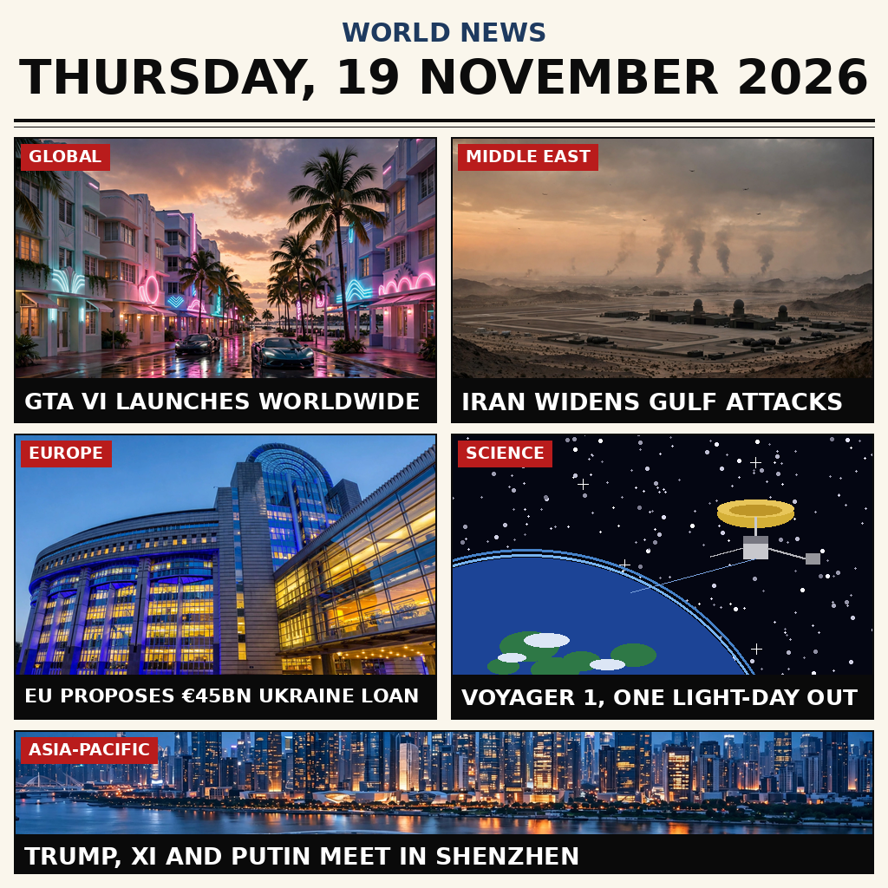

# 19 November 2026 — The Day in Five Stories

[](https://make.fun/c/news-image-20261119)
[](https://make.fun/c/news-image-20261119)
[](https://make.fun/c/news-image-20261119)

Entry for the [make.fun](https://make.fun/c/news-image-20261119) bounty
**"Sum up 19 November's world news in one image"** (`news-image-20261119`):
a newspaper front page, 1024×1024, summing up Thursday 19 November 2026
in five stories, one per region and beat.



## The five stories

| Region | Headline | Subhead |
| --- | --- | --- |
| Global | GTA VI LAUNCHES WORLDWIDE | ~16M pre-orders · $1.5B+ in pre-sales |
| Middle East | IRAN WIDENS GULF ATTACKS | Drones hit US base in Kuwait; Bahrain struck again |
| Europe | EU PROPOSES €45BN UKRAINE LOAN | Covers two-thirds of Ukraine's €70bn 2027 gap |
| Science | VOYAGER 1, ONE LIGHT-DAY OUT | 16bn miles out — first at one light-day |
| Asia-Pacific | TRUMP, XI AND PUTIN MEET IN SHENZHEN | First-ever meeting of the three leaders |

## Layout

A navy masthead names the day — **THURSDAY, 19 NOVEMBER 2026** — under
a "WORLD NEWS" flag and over "THE DAY IN FIVE STORIES". Below it, a 2×2
grid carries the first four stories and a full-width strip carries the
fifth. Every panel has a red region tag, a photographic image, a headline
bar and a one-line subhead, so a reader who missed the day can tell what
happened from the image alone. All lettering is crisp vector text,
legible at about 300 pixels across.

## v2 changes

This is the second version of the entry. It fixes the two weaknesses of
the first:

1. **Voyager 1 is photographic now.** The v1 panel was a flat cartoon
   drawing of the probe; v2 uses a photorealistic deep-space render —
   gold dish, white body, star field, and the blue limb of Earth along
   the bottom of the frame.
2. **Every headline has a subhead.** v1 carried headlines only; v2 adds
   one informative line under each, with the key number or detail of the
   story.

## How it is built

`compose.py` (Python 3, Pillow) lays out the page from the five photo
panels (`panel-*.webp`) and writes `entry.png`. It is deterministic:
fixed inputs, fixed fonts, no timestamps, no randomness — repeated runs
write byte-identical output.

```sh
python3 compose.py   # writes entry.png (1024x1024, under 1 MiB)
```

`main.ts` (Node 22, standard library only, no network) is the program
the grader runs: it checks `entry.png` against the size and dimension
limits and copies it to `/output/entry.png`.

```sh
mkdir -p out && MAKEFUN_OUTPUT_DIR=out node main.ts
```

## License

MIT — see [LICENSE](LICENSE).
